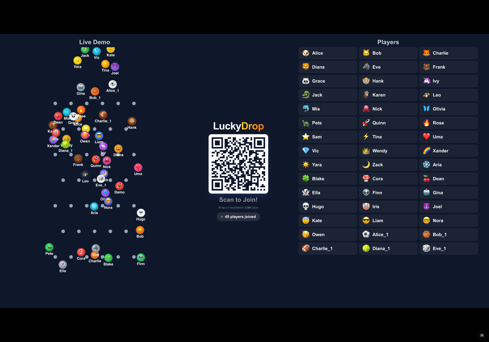
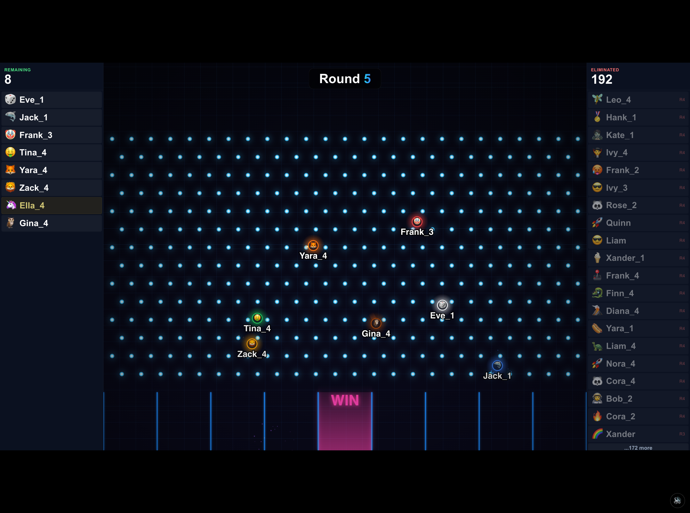
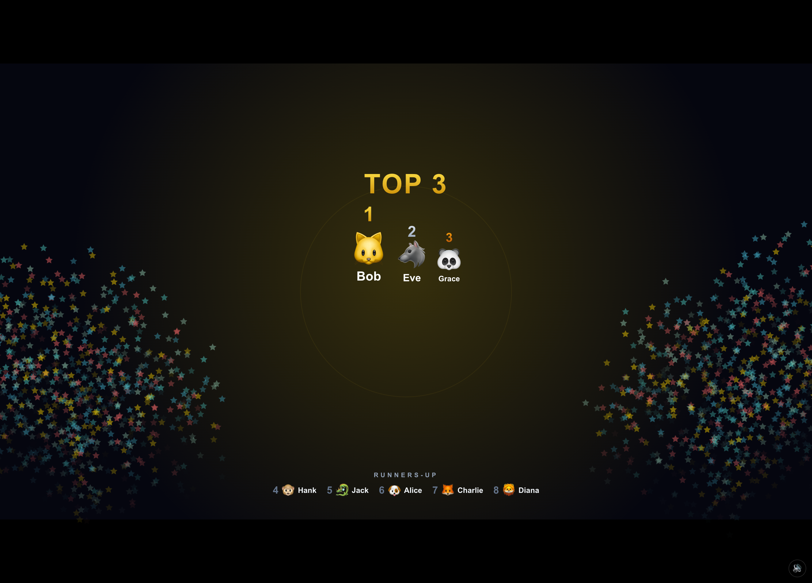
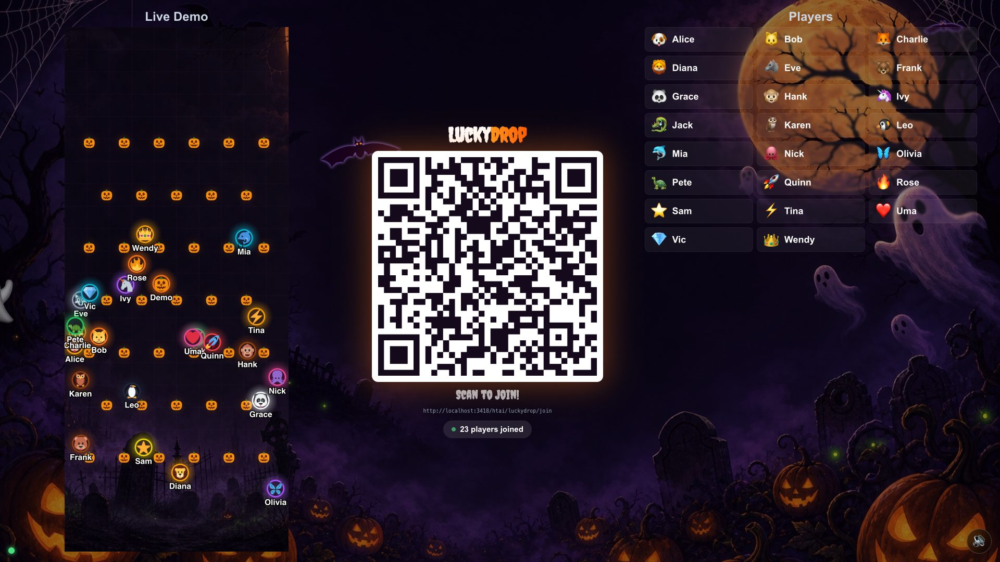
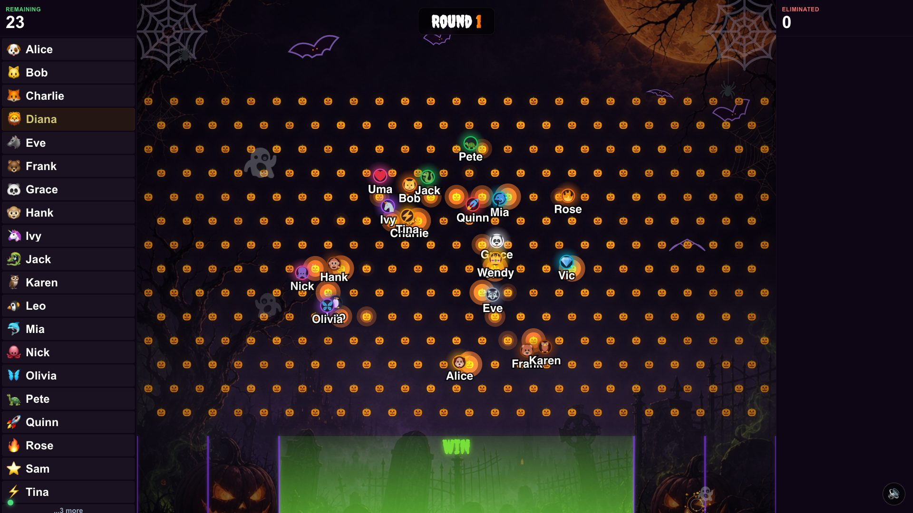
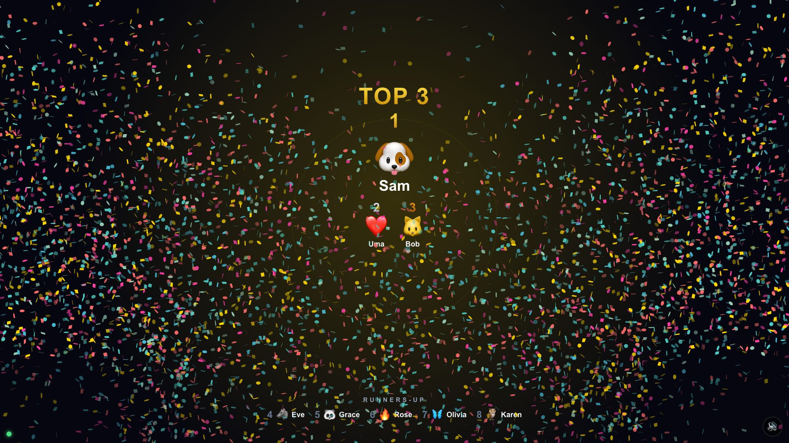
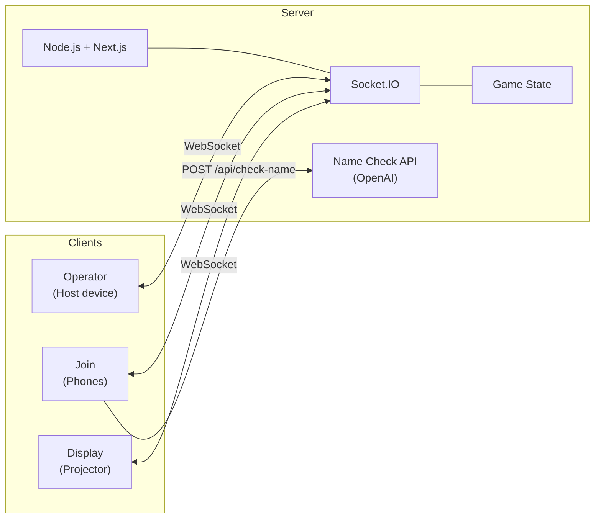
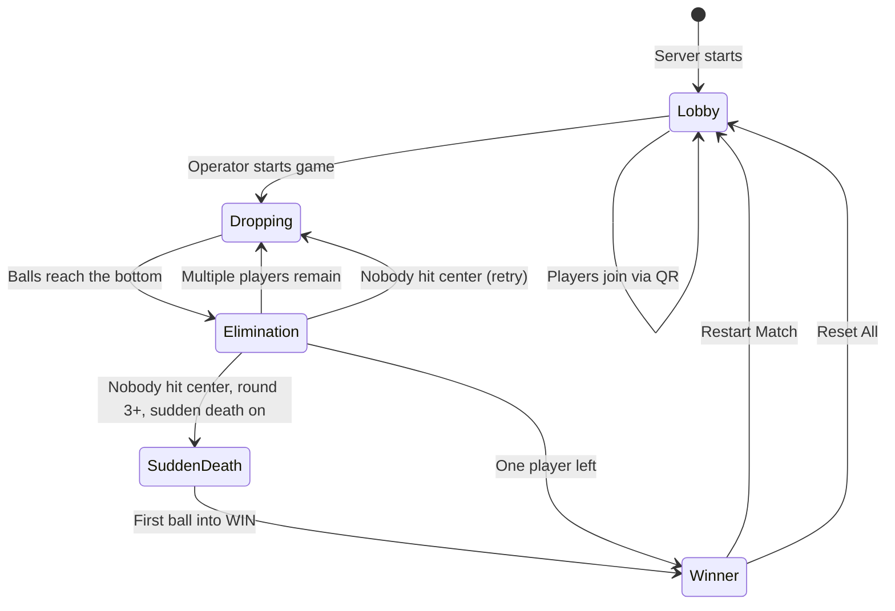

# LuckyDrop

**Turn any event into an unforgettable moment.** LuckyDrop is a real-time Plinko lucky draw that gets your whole audience on their feet. Attendees join from their phones, their emoji balls drop through a physics-powered Plinko board on the big screen, and rounds of elimination build tension until one winner remains.

No app install. No sign-up. Just scan, drop, and win.

**[Watch the LuckyDrop 2.0 video on YouTube](https://www.youtube.com/watch?v=9KNnFaiOVHA)** · **[Project page](https://hanley-tech.github.io/luckydrop/)**

| Lobby | Gameplay | Final Round |
|:---:|:---:|:---:|
|  |  |  |
|  |  |  |

### Why LuckyDrop?

- **Instant engagement** — Attendees scan a QR code and they're in. No downloads, no accounts.
- **Neon spectacle** — A glowing "Geometry Wars"-style board: animated grid, bloom pegs, per-player neon balls with motion trails, particle bursts, and star explosions in the win zone.
- **Cinematic moments** — Automatic slow-motion with camera push-in and screen shake for the big beats: the winning drop, the first ball into the win zone, and near-misses.
- **Real physics** — Matter.js powers the Plinko board. Every drop is different. Every round is suspenseful.
- **Themes** — Switch the whole room between *Neon* and *Halloween* (graveyard board, jack-o'-lantern pegs, flying bats, ghosts, lightning, its own music and sounds) from the operator panel, even mid-match.
- **Dynamic audio** — Synthesized techno sound effects (peg pings, explosions, win chimes — no files required), plus TTS announcements and background music that speeds up with a tension pulse as the field narrows to the final few.
- **Sudden death** — Optional: if the final round ends with nobody in, skip the endless retries — misses drop straight back in from the top and the first ball into WIN takes it.
- **Pick your prizes** — Award 1 to 5 winners; the finish shows a ranked podium (gold/silver/bronze) plus runners-up.
- **Multiple boards** — *Classic*, *Cannon Crossfire*, and *Lunch Tray* levels change the obstacles and the chaos.
- **Works on any screen** — Designed for projectors and TVs at 16:9 (4K-ready). Emojis render as bundled images, so they show even on machines whose OS emoji font doesn't draw to canvas.
- **Operator control** — Run the show from your phone. Start rounds, set the winner count, level, language and theme, remove players, restart matches. A built-in illustrated **operator guide** (Chinese/English) walks a new host through a whole event.
- **Bilingual** — Simplified Chinese and English, switched for every screen at once from the operator panel.
- **Resilient** — The display auto-reconnects after the machine sleeps or the network blips, with a live connection indicator so you always know its status.
- **Self-hosted & free** — Run it on your own machine. No subscriptions, no vendor lock-in.

## Quick Start

```bash
git clone https://github.com/your-username/luckydrop.git
cd luckydrop
npm install
npm run dev
```

Open three browser tabs:

1. **http://localhost:3000** — Display screen (projector / shared screen)
2. **http://localhost:3000/join** — Player join page (or scan the QR code from a phone)
3. **http://localhost:3000/operator** — Your control panel

Add test players from the operator panel, hit **Start Game**, and watch the balls drop.

## How It Works

LuckyDrop has three views connected via WebSockets:

- **Display** (`/`) — The main screen shown to the audience. Shows a QR code during lobby, a physics-based Plinko board during gameplay, and celebration effects for the winner.
- **Join** (`/join`) — Mobile-friendly page where players scan the QR code and enter their name + emoji.
- **Operator** (`/operator`) — Control panel to start rounds, manage players, and run the game.

### Architecture



### Game Flow



1. Show the display screen and let players scan the QR code to join
2. The operator (optionally) picks a **level** and how many **prize winners** to award, then starts the game — all player balls drop through the Plinko board
3. The instant a ball reaches the bottom, it's decided: land in the center "WIN" zone to advance (star burst), otherwise you explode and are out
4. Rounds repeat with remaining players until a champion is crowned; the finish shows the ranked **podium** (top N winners) plus runners-up

## User Guide

### For the Event Host / Operator

#### Before the Event

1. Start LuckyDrop on a machine connected to the same network as your attendees
2. Open the **Display** (`/`) on a projector or large screen — it shows a QR code and the join URL
3. Open the **Operator** panel (`/operator`) on your phone or laptop

#### Running a Draw

1. **Lobby phase** — Attendees scan the QR code and enter their name + emoji. The display shows players as they join. Before starting, optionally pick a **level** and the number of **prize winners** (1–5). Wait until everyone is in.
2. **Start the game** — Tap "Start Game" on the operator panel. All player balls drop through the Plinko board simultaneously.
3. **Elimination** — The moment a ball hits the bottom it's decided: land in the center "WIN" zone to advance (star burst), otherwise it explodes and is out. The left sidebar shows remaining players, the right sidebar shows eliminated ones. As the field shrinks the music speeds up and a tension pulse kicks in.
4. **Subsequent rounds** — The next round starts automatically after a short pause. The win zone narrows (5 slots → 3 → a single slot from round 3) and slow-motion kicks in for the decisive drops. If nobody lands in WIN, the round replays with nobody eliminated.
   - **Sudden death** (if enabled) — When a round on the single-slot board (round 3+) ends with nobody in, the display announces **SUDDEN DEATH! FIRST ONE WINS!** instead of replaying. Balls drop continuously: a miss pops and drops straight back in from the top, and the first ball into WIN is the champion. Everyone else still in sudden death is ranked by how far down the board their ball was at that moment (lowest = 2nd); players knocked out in earlier rounds keep their normal ranking.
5. **Winner(s)** — When the field resolves, the display celebrates with confetti and shows the ranked **podium** — the champion (or your top N prize winners) plus runners-up.
6. **Play again** — Use "Restart Match" to go back to lobby with the same players (resets the music too), or "Reset All" to clear everything.

#### Operator Controls

| Control | What it does |
|--------|-------------|
| **Level** (lobby only) | Choose the board: Classic, Cannon Crossfire, or Lunch Tray |
| **Prize winners** (lobby only) | Set how many top places to celebrate (1–5) — the podium size at the finish |
| **Sudden death** (any time) | Checkbox. A no-winner round on the single-slot board (round 3+) goes to sudden death instead of replaying forever. Can be ticked mid-match to rescue a stuck final; unticking doesn't stop a sudden death already running |
| **Language** (any time) | 中文 / English for the big screen, every phone and the spoken announcements |
| **Theme** (any time) | Neon / Halloween for the big screen and every phone, sounds included |
| **📖 Operator Guide** | Opens the illustrated how-to at `/operator/guide` in a new tab |
| **Start Game** | Begins round 1 (only available in lobby with players) |
| **Restart Match** | Returns to lobby, keeps all players for another round (resets the soundtrack) |
| **Reset All** | Clears everything — players, scores, game state |
| **Remove** (per player) | Removes a specific player from the game |

#### Debug Tools

The operator panel includes debug tools for testing:

- **Add 5 / Add 40 Test Users** — Populates the game with fake players
- **Name Check toggle** — Enables/disables OpenAI name moderation (requires a funded `OPENAI_API_KEY`; off by default)

#### Themes

Pick **Neon** (default) or **Halloween** from the operator panel. Like language, the theme is owned by the server: it restyles the big screen and every phone at once, and can change mid-match. Halloween swaps the board for a painted graveyard with jack-o'-lantern pegs, flying bats, ghosts, spiders and lightning, uses a creepy title font (English text only), and has its own music and sound effects.

Themes live in `src/lib/theme.ts` (palette, art, font, sound pack). Board ambience is in `src/components/game/fx/spooky.ts`, art in `public/themes/<theme>/`, and a theme's sound pack in `public/sounds/<theme>/` under the default filenames.

#### Operator Guide

The operator panel links to an illustrated guide at `/operator/guide` (Chinese/English, follows the room's language). Its screenshots are generated, not hand-made. To refresh them after a UI change, start a **scratch** server (the script resets the game and runs whole matches) and run:

```bash
PORT=3418 npm run dev            # in another terminal
node scripts/guide-shots.mjs http://localhost:3418   # add your NEXT_PUBLIC_BASE_PATH if set
```

It uses your installed Google Chrome (muted) and writes `public/guide/<lang>/*.jpg`.

To record demo footage for a video, `scripts/demo-capture.mjs` captures the display at ~60 fps with the game's music and effects as separate stems (also against a scratch server):

```bash
node scripts/demo-capture.mjs http://localhost:3418 <out dir> [lobby sudden-death operator join]
```

### For Players

1. Scan the QR code on the display screen (or navigate to the join URL)
2. Enter your name (1-8 characters) and pick an emoji
3. Tap "Join!" and wait for the host to start the game
4. Watch the display screen — your emoji ball drops through the Plinko board
5. If your ball lands in the center zone, you advance. Otherwise, you're eliminated.
6. Your phone shows your current status (waiting, still in, eliminated, or winner)

### Tips for a Great Draw

- **Network**: The display machine and players' phones need to be on the same WiFi network
- **Audio**: The display shows a one-time **"Tap to enable sound"** overlay — click it once at the start (browsers block autoplay until a click). After that, sound effects and music play for the whole session. Use the speaker button (bottom-right) to mute/unmute. Core sound effects are synthesized in the browser, so they work even with no audio files installed.
- **Connectivity**: A small dot (bottom-left on the display) shows connection status — green when connected, a red "Reconnecting…" pill if the socket drops. The display self-heals after the machine sleeps or the network blips; no refresh needed.
- **Sizing**: The display is designed for 16:9 screens and scales proportionally. Works best on a projector or TV.
- **Player count**: Comfortably runs 80+ concurrent players; the neon board and emoji balls are pre-baked into sprites so the frame rate holds up. Elimination narrows the field fast so rounds stay exciting.
- **Name moderation**: For public events, set a funded `OPENAI_API_KEY` and enable name checking from the operator panel to filter inappropriate names. Without it, name checking is off and all (length-valid, non-duplicate) names are accepted.

## Setup

### Prerequisites

- Node.js 18+
- npm

### Configure

```bash
cp .env.example .env.local
```

| Variable | Description | Required |
|----------|-------------|----------|
| `OPENAI_API_KEY` | OpenAI API key for name moderation | Optional |
| `PORT` | Server port (default: `3000`) | No |
| `NEXT_PUBLIC_BASE_PATH` | Base path for reverse proxy deployments | No |

Name moderation uses OpenAI to filter inappropriate player names. If no API key is set, name checking is disabled and all names are accepted.

### Sound Files

The game's **sound effects are synthesized in the browser** (Web Audio) and need
no files. On top of that, LuckyDrop ships a **CC0 default set** in
`public/sounds/default/` — background music plus richer file-based SFX — so
audio works out of the box with nothing to install. Every file is public domain
(Kenney + OpenGameArt); see [`public/sounds/default/CREDITS.md`](public/sounds/default/CREDITS.md).

Themes bring their own packs: the **Halloween** theme plays `public/sounds/halloween/`
(public domain / CC0 / CC BY — see its [`CREDITS.md`](public/sounds/halloween/CREDITS.md)),
which also ships in the repo. A theme pack uses the same filenames as the default set.

**To use your own music/SFX instead** (e.g. tracks from a subscription library),
drop `.mp3`s directly into `public/sounds/` and point `public/sounds/sounds.json`
at the bare filenames:

```json
{
  "sfx": {
    "playerJoined": "player-joined.mp3",
    "gameStart": "game-start.mp3",
    "ballCenter": "ball-center.mp3",
    "roundComplete": "round-complete.mp3",
    "retry": "retry.mp3",
    "winnerCheers": "winner-cheers.mp3",
    "powerUp": "power-up.mp3"
  },
  "music": {
    "lobby": "lobby.mp3",
    "game": "game.mp3",
    "transition": "transition.mp3",
    "winner": "winner.mp3"
  }
}
```

`public/sounds/` itself is gitignored (only `default/` is committed), so licensed
audio you add there can never be committed by accident. Set any entry to `null`
or remove it to skip that sound.

> Next.js indexes `public/` at startup — **restart the server** after adding files
> or they will 404.

### Running in Production

```bash
npm run build
npm start
```

Or use the included control script:

```bash
./luckydrop.sh dev      # Start dev server in background
./luckydrop.sh start    # Build and start production server
./luckydrop.sh stop     # Stop the server
./luckydrop.sh status   # Check if running
./luckydrop.sh logs     # Tail the log file
```

### Remote Deployment

For deploying to a remote server via SSH and PM2, configure the `DEPLOY_*` variables in `.env.local` (see `.env.example`) and run:

```bash
./deploy.sh
```

## Hosting for Free

LuckyDrop requires a **persistent Node.js server** for WebSocket connections, so static hosts and serverless platforms (Vercel, Netlify, Cloudflare Pages) won't work. Here are free options that do:

| Platform | Free Tier | Best For | Notes |
|----------|-----------|----------|-------|
| **Your laptop** | Free | One-off events | Simplest option — just run on the same WiFi as your attendees. No internet needed. |
| [Railway](https://railway.app) | $5/month credit | Hosted events | Deploy from GitHub, supports WebSockets. Sleeps after inactivity but wakes fast. |
| [Render](https://render.com) | Free web service | Hosted events | Auto-deploys from GitHub. Free tier spins down after 15 min idle — fine for events since you spin it up beforehand. |
| [Fly.io](https://fly.io) | 3 shared VMs free | Always-on hosting | Closest to a real VPS. Needs `flyctl` CLI to deploy. Great if you want a persistent URL. |
| [Glitch](https://glitch.com) | Free | Quick demos | Import from GitHub, instant URL. Sleeps after 5 min idle but wakes on first request. |

**Recommendation:** For most people, just run it on your laptop at the event. It's the simplest setup and doesn't require internet — everyone just needs to be on the same WiFi. If you want a public URL for remote participants, Railway or Render are the easiest to set up.

## Tech Stack

- **Next.js 14** — React framework with App Router
- **Socket.IO** — Real-time WebSocket communication (with auto-reconnect)
- **Matter.js** — 2D physics engine for the Plinko board
- **Canvas 2D** — Neon board rendering, cached sprites, particle systems, and the cinematic slow-mo camera
- **Web Audio API** — Synthesized techno sound effects and dynamic music tempo/pulse
- **Twemoji** — Bundled emoji images so avatars render on any device
- **canvas-confetti** — Winner celebration
- **Tailwind CSS** — Styling
- **OpenAI API** — Optional name moderation

## License

[MIT](LICENSE)
